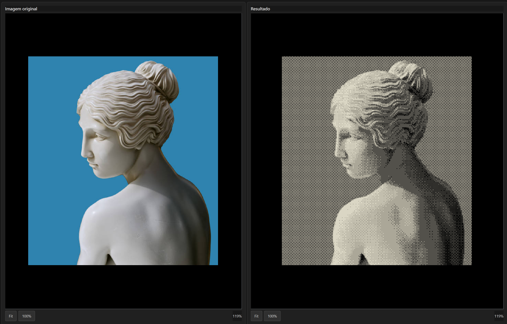

# RuinPrint

<p align="center"></p>

**A desktop editor for aged, analog and print-inspired image treatments.**

RuinPrint is a Windows desktop application for turning photographs into deliberately imperfect, limited-palette images inspired by old prints, film, engraving and degraded media. It combines a non-destructive preview workflow with full-resolution PNG export and recoverable processing settings.

> Interface language: Brazilian Portuguese. Current application version: **1.0.0**.

## Highlights

- Import PNG, JPEG, WebP and BMP images, including drag and drop and multi-image sessions.
- Compare the source and result side by side, with synchronized zoom and pan.
- Shape the image with tone controls, color palettes, dithering, print and ink effects, focus, lens imperfections and final degradation.
- Work with factory presets and save, rename, update or remove personal presets.
- Undo and redo setting changes; copy settings between images.
- Export the processed image as a full-resolution PNG while keeping transparency.
- Embed a versioned RuinPrint settings snapshot in PNG metadata so a compatible export can restore its editing configuration.
- Run as a portable ONEDIR build or install per user with the included Inno Setup configuration.

## Screenshots

Real application screenshots are included in the technical guide (pages 12-15) and stored in [`docs/screenshots/`](docs/screenshots/). The comparison below shows the original image beside a processed result.



## How the image pipeline works

```mermaid
flowchart LR
    A[Import image] --> B[EXIF orientation and RGBA]
    B --> C[Preview up to 1200 px]
    C --> D[Tone]
    D --> E[Palette and dithering]
    E --> F[Dither structure]
    F --> G[Engraving]
    G --> H[Black consumption]
    H --> I[Print and ink]
    I --> J[Focus map and blur]
    J --> K[Lens effects]
    K --> L[Film and surface degradation]
    L --> M[Result preview]
    B --> N[Full-resolution export]
    N --> D
    M --> N
    N --> O[PNG with embedded settings]
```



Preview and export use the same processing pipeline. Export starts from the original full-resolution image rather than enlarging the preview.

## Run from source

Requirements: Windows, Python 3.13, and the packages listed in `requirements.txt`.

```powershell
python -m venv .venv
.\.venv\Scripts\Activate.ps1
python -m pip install --upgrade pip
python -m pip install -r requirements.txt
python app.py
```

The interface and installer messages are currently in Brazilian Portuguese. The repository does not yet include an automated test suite or a cross-platform release workflow.

## Build for Windows

The build scripts expect the project's `.venv` and use PyInstaller plus Inno Setup for the installer:

```powershell
.\build_windows.ps1
```

This creates `dist\RuinPrint`, an ONEDIR portable application. To compile the installer after the portable build:

```powershell
.\build_installer.ps1
```

The combined build script is:

```powershell
.\build_release.ps1
```

The installer compiler (`ISCC.exe`) must be installed. Build outputs and assembled release packages are intentionally excluded from Git; publish release binaries separately when preparing a release.

## Architecture

RuinPrint uses Python for application logic, PySide6 for the desktop interface, Pillow for image loading/export, NumPy and OpenCV for pixel and color operations, and PyInstaller/Inno Setup for Windows packaging.

| Area | Responsibility |
| --- | --- |
| `app.py` | Creates the Qt application and main window. |
| `ui/` | Main window, editing controls, image views and visual theme. |
| `core/` | Image documents, pipeline settings, processing orchestration, presets, metadata, export, history and application paths. |
| `effects/` | Tone, palette, dithering, engraving, ink, focus, lens and degradation operations. |
| `workers/` | Background preview and export workers. |
| `presets/` | Factory preset definitions and palette presets. |
| `packaging/` | PyInstaller ONEDIR specification and Windows version information. |
| `installer/` | Inno Setup installer definition. |
| `docs/` | Technical guide and future project screenshots. |

The technical guide at [`docs/RuinPrint_Documentacao_Tecnica_PT-BR.pdf`](docs/RuinPrint_Documentacao_Tecnica_PT-BR.pdf) describes the modules, data flow, decisions, limitations and release process in more detail.

## Data and privacy

- `settings.ini` stores window and interface preferences beside the application in its `data/` directory.
- `user_presets.json` stores personal presets in the same directory. These files are runtime data and are ignored by Git.
- Factory presets are read from `presets/factory_presets.json`.
- PNG metadata contains RuinPrint processing settings, not a copy of the source image.
- Source images are processed locally by the desktop application; this project does not define an upload service.

## License

No reuse license has been selected yet. The source is published for project review; public visibility alone does not grant permission to reuse, modify or redistribute it.

## Roadmap

- Add automated checks for image-processing behavior and PNG settings metadata.
- Continue refining the image controls and palette workflow.
- Publish versioned Windows releases with the portable package and installer.
